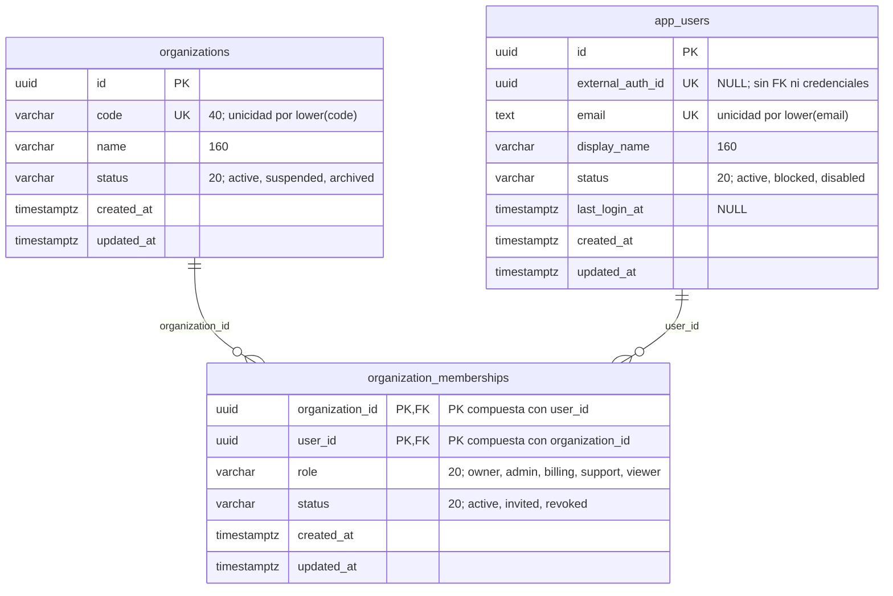

# ERD — identidad y membresías

Los nombres del diagrama corresponden a `iam.organizations`, `iam.app_users` y `iam.organization_memberships`. Se muestran todas las columnas de las tres tablas. `PK` indica clave primaria, `FK` clave foránea y `UK` unicidad. La marca `NULL` señala una columna opcional; las demás son `NOT NULL`.

Una organización puede tener cero o muchas membresías. Un operador puede tener cero o muchas membresías y pertenecer a varias organizaciones. Cada membresía exige exactamente una organización y un operador; su clave primaria compuesta permite un solo registro por pareja `(organization_id, user_id)`. La eliminación de sus referencias usa `ON DELETE RESTRICT`.

`external_auth_id` no se relaciona con otra tabla en esta migración. La autenticación, las credenciales y las sesiones siguen pendientes y no están dibujadas como entidades existentes. El operador interno no es lo mismo que un cliente de `crm.customers` ni que una cuenta LOGIN de PostgreSQL.

Las referencias a operadores desde clientes y eventos se muestran en [[03-ERD-CRM]], [[04-ERD-Auditoria]] y [[05-Mapa-General]].
