# ERD — clientes

El diagrama contiene las ocho tablas reales de `crm` y sus referencias a `iam.organizations` y `iam.app_users`. Se muestran todas las columnas CRM; las entidades IAM se reducen a `id` para dar contexto y tienen su detalle en [[02-ERD-IAM]]. `NULL` identifica columnas opcionales; `PK`, `FK` y `UK` indican claves primarias, foráneas y unicidad.

```mermaid
erDiagram
    organizations ||..o{ customers : "organization_id"
    app_users |o..o{ customers : "created_by"
    app_users |o..o{ customers : "updated_by"
    customers ||--o| customer_contacts : "organization_id, customer_id"
    customers ||..o{ customer_addresses : "organization_id, customer_id"
    customers ||--o| customer_billing_profiles : "organization_id, customer_id"
    customers ||--o| customer_accounts : "organization_id, customer_id"
    customers ||--o| customer_assignments : "organization_id, customer_id"
    customers ||..o{ customer_devices : "organization_id, customer_id"
    customers ||..o{ customer_payment_gateways : "organization_id, customer_id"

    organizations {
        uuid id PK
    }

    app_users {
        uuid id PK
    }

    customers {
        uuid id PK "UNIQUE compuesto con organization_id"
        uuid organization_id FK "UNIQUE compuesto con id y con custom_id_suffix"
        varchar custom_id_suffix "32; UNIQUE por organizacion"
        varchar custom_id "34; generado como CC mas custom_id_suffix"
        varchar person_type "24; individual, company, other"
        varchar display_name "200"
        varchar first_name "100; NULL"
        varchar middle_name "100; NULL"
        varchar first_last_name "100; NULL"
        varchar second_last_name "100; NULL"
        varchar document_id "80; NULL; unicidad condicional por organizacion"
        varchar status "20; active, inactive, blocked"
        boolean portal_access_enabled
        text notes
        integer version
        uuid created_by FK "NULL"
        uuid updated_by FK "NULL"
        timestamptz created_at
        timestamptz updated_at
        timestamptz deleted_at "NULL"
    }

    customer_contacts {
        uuid customer_id PK,FK "FK compuesta con organization_id"
        uuid organization_id FK "FK compuesta con customer_id"
        text email "NULL; unicidad condicional por organizacion"
        varchar mobile_phone "32; NULL"
        varchar landline_phone "32; NULL"
        boolean notify_email
        boolean notify_sms
        boolean notify_whatsapp
        timestamptz created_at
        timestamptz updated_at
    }

    customer_addresses {
        uuid id PK
        uuid organization_id FK "FK compuesta con customer_id"
        uuid customer_id FK "FK compuesta con organization_id"
        varchar address_type "20; service, billing, other"
        boolean is_primary
        varchar street "180"
        varchar exterior_number "40; NULL"
        varchar neighborhood "120"
        varchar city "120"
        varchar state_region "120"
        varchar postal_code "16"
        char country_code "2"
        numeric latitude "9,6; NULL"
        numeric longitude "9,6; NULL"
        text additional_data
        timestamptz created_at
        timestamptz updated_at
    }

    customer_billing_profiles {
        uuid customer_id PK,FK "FK compuesta con organization_id"
        uuid organization_id FK "FK compuesta con customer_id"
        boolean enabled
        varchar tax_id "40; NULL; unicidad condicional por organizacion"
        varchar legal_name "220; NULL"
        varchar legal_entity "160; NULL"
        varchar tax_regime "160; NULL"
        varchar invoice_type "60"
        smallint billing_day
        varchar payment_method "100; NULL"
        varchar payment_form "100; NULL"
        varchar cfdi_use "120; NULL"
        boolean inform_after_payment
        boolean automatic_status
        boolean email_invoice
        boolean email_payment
        text[] notification_emails
        text additional_info
        text additional_info_2
        timestamptz created_at
        timestamptz updated_at
    }

    customer_accounts {
        uuid customer_id PK,FK "FK compuesta con organization_id"
        uuid organization_id FK "FK compuesta con customer_id"
        varchar account_status "24; current, credit, debt"
        numeric balance "14,2"
        numeric available_credit "14,2"
        integer unpaid_invoices
        char currency "3"
        timestamptz created_at
        timestamptz updated_at
    }

    customer_assignments {
        uuid customer_id PK,FK "FK compuesta con organization_id"
        uuid organization_id FK "FK compuesta con customer_id"
        varchar zone_name "120"
        varchar seller_name "160"
        varchar collector_name "160"
        timestamptz created_at
        timestamptz updated_at
    }

    customer_devices {
        uuid id PK
        uuid organization_id FK "FK compuesta con customer_id"
        uuid customer_id FK "FK compuesta con organization_id"
        varchar device_name "160"
        varchar platform "30; NULL"
        bytea push_token_ciphertext "NULL; cifrado por backend"
        varchar push_token_fingerprint "64; NULL; unicidad condicional por organizacion"
        varchar status "20; active, revoked"
        timestamptz last_seen_at "NULL"
        timestamptz created_at
        timestamptz updated_at
    }

    customer_payment_gateways {
        uuid id PK
        uuid organization_id FK "FK compuesta con customer_id"
        uuid customer_id FK "FK compuesta con organization_id"
        varchar provider "40; UNIQUE con organization_id y customer_id"
        varchar external_account_reference "180; NULL"
        boolean enabled
        boolean notify_invoices
        timestamptz created_at
        timestamptz updated_at
    }
```

## Cardinalidades y restricciones

Cada cliente exige una organización. `created_by` y `updated_by` son referencias opcionales a operadores: al eliminar un operador, PostgreSQL establece esas referencias en `NULL`. Estas claves no exigen que el operador tenga una membresía en la misma organización; la autorización se evalúa por las políticas y el contexto de la operación.

Los contactos, el perfil de facturación, la cuenta y la asignación tienen `customer_id` como clave primaria. Por eso cada cliente admite **cero o uno** de cada registro, no uno obligatorio. No hay disparador en esta migración que cree automáticamente esas filas.

Las direcciones, los dispositivos y las pasarelas tienen un `id` propio y permiten **cero o muchos** registros por cliente. Las siete tablas dependientes usan `(organization_id, customer_id)` para referenciar `(organization_id, id)` de `crm.customers`, con `ON DELETE CASCADE`. Su `organization_id` no tiene una FK directa adicional hacia IAM: la consistencia de organización se exige a través del cliente.

| Restricción relevante | Alcance real |
| --- | --- |
| Identificador del cliente | `(organization_id, custom_id_suffix)` es único; `custom_id` se calcula con el prefijo `CC`. |
| Documento del cliente | `lower(document_id)` único por organización cuando no es `NULL` y el cliente no está archivado. |
| Correo de contacto | `lower(email)` único por organización cuando no es `NULL`. |
| Dirección principal | Como máximo una fila `is_primary = true` por organización, cliente y tipo de dirección. |
| Identificador fiscal | `lower(tax_id)` único por organización cuando no es `NULL` y el perfil está habilitado. |
| Huella de token | Única por organización cuando no es `NULL`. |
| Pasarela | Una fila por combinación `(organization_id, customer_id, provider)`. |

`customer_accounts` es un resumen inicial. No existe en esta migración un ledger, tabla de facturas o movimientos contables que lo alimenten. `seller_name`, `collector_name` y `zone_name` son textos, sin FK hacia catálogos. Los dispositivos aquí descritos corresponden al registro del cliente y sus notificaciones; no constituyen un modelo de equipos o topología de red.

Ver [[04-ERD-Auditoria]] para los eventos y [[06-Dominios-Planeados]] para el trabajo posterior.
