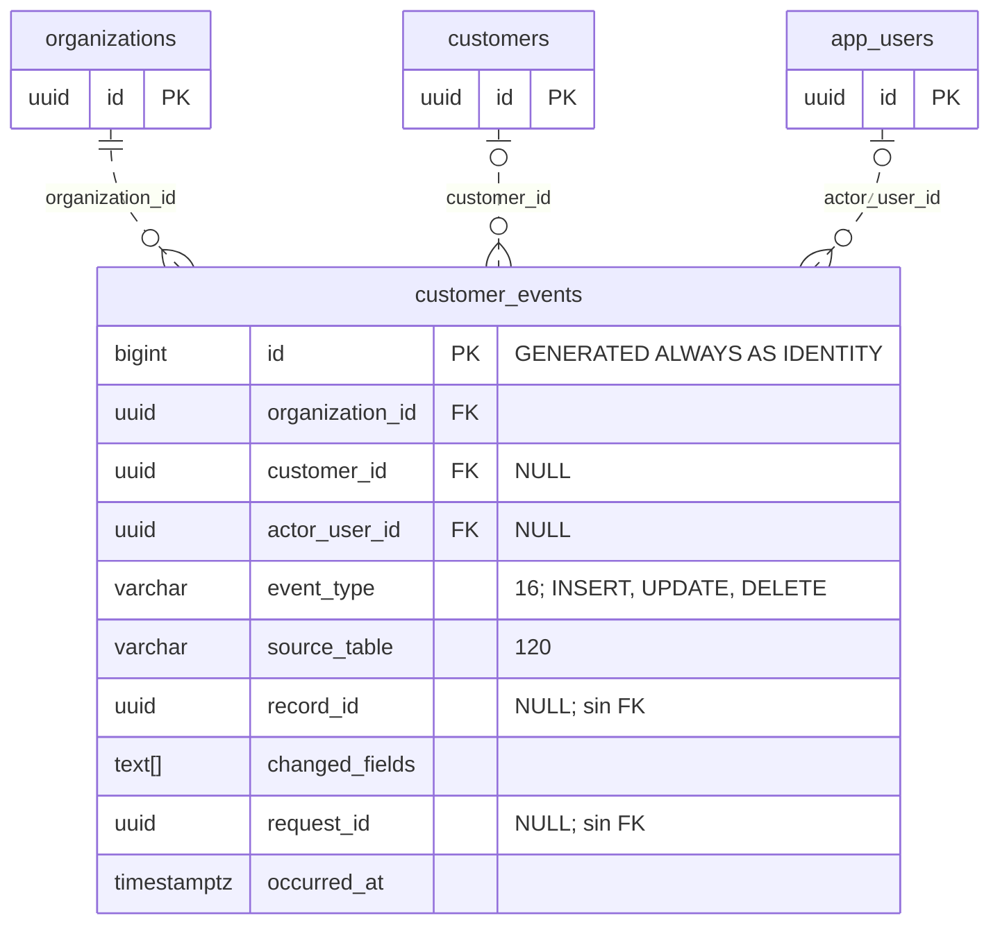

# ERD — auditoría de clientes

`audit.customer_events` registra cambios en las ocho tablas CRM. Las entidades de contexto son `iam.organizations`, `crm.customers` e `iam.app_users`. Se muestran todas las columnas del evento. `NULL` identifica columnas opcionales; `PK` y `FK` indican claves primarias y foráneas.

Cada evento exige una organización, con `ON DELETE RESTRICT`. Puede conservar cero o una referencia a cliente y cero o una referencia a operador; esas referencias usan `ON DELETE SET NULL`. Una organización, un cliente o un operador pueden tener cero o muchos eventos.

`customer_id` referencia únicamente `crm.customers.id`, sin FK compuesta con `organization_id`. `record_id`, `source_table` y `request_id` aportan trazabilidad, pero no son claves foráneas hacia tablas adicionales. Por eso no se dibujan entidades de peticiones ni registros genéricos inexistentes.

## Generación y contenido del evento

`app_private.audit_customer_change` se ejecuta después de `INSERT`, `UPDATE` y `DELETE` en las ocho tablas CRM. Obtiene la organización y el cliente desde la fila, identifica la tabla de origen y registra los nombres de campos cuyo valor cambió. Excluye `updated_at` y `version` de `changed_fields`. Toma el actor desde `app.user_id` y la petición desde `app.request_id`.

La tabla no almacena snapshots ni valores personales anteriores o nuevos. Es una bitácora de operaciones de datos, distinta de la [[2026-10-09|bitácora técnica de Obsidian]], que registra cambios de código, esquema y decisiones.

El diseño concede lectura de eventos al rol de aplicación y deja su creación al disparador. El complemento local `003_local_security.sql`, ya aplicado según la tarea principal, fuerza RLS en eventos y asigna `audit_customer_change` a `comecore_audit_writer`, un rol interno `NOLOGIN` y `BYPASSRLS` con `INSERT` en eventos y `USAGE` de su secuencia. No tiene permiso de lectura, actualización o eliminación de eventos y no se concede a las cuentas LOGIN. La cuenta runtime ya no tiene permiso de acceso directo a la secuencia.

La expresión «append-only» describe el contrato de uso de la aplicación; no demuestra que una cuenta administrativa o superusuario no pueda modificar filas. Las pruebas SQL locales comprobaron que el runtime no puede insertar, actualizar o eliminar eventos directamente, y que el disparador enlaza actor, cliente, organización y `request_id`, guardando nombres de campos sin copiar sus valores privados. La transacción de prueba se revirtió.

`event_type = 'DELETE'` y los disparadores de eliminación existen en el modelo, aunque `comecore_app` no tiene privilegio `DELETE` sobre CRM. Esta definición no equivale a una operación de borrado disponible desde el ERP.
