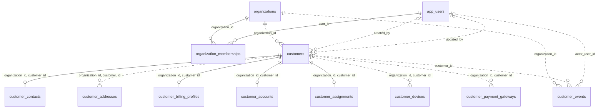

# Mapa general — modelo SQL inicial

Este mapa reúne las 12 tablas de dominio existentes y todas sus relaciones FK. Los atributos se detallan en [[02-ERD-IAM]], [[03-ERD-CRM]] y [[04-ERD-Auditoria]]. Los nombres sin prefijo pertenecen al esquema indicado en la tabla de referencia. La preparación local también creó una tabla técnica de historial, documentada por separado en [[07-Control-Tecnico-Migraciones]] y sin relaciones con los dominios.

| Esquema | Tablas |
| --- | --- |
| `iam` | `organizations`, `app_users`, `organization_memberships` |
| `crm` | `customers`, `customer_contacts`, `customer_addresses`, `customer_billing_profiles`, `customer_accounts`, `customer_assignments`, `customer_devices`, `customer_payment_gateways` |
| `audit` | `customer_events` |
| `app_private` | Funciones auxiliares y tabla técnica `schema_migrations` creada por el script de preparación local; fuera del mapa de dominio. |

## Cómo leerlo

- `||`: exactamente uno.
- `|o`: cero o uno en el extremo izquierdo; `o|`: cero o uno en el derecho.
- `o{`: cero o muchos en el extremo derecho.
- La etiqueta identifica la FK real. Las siete relaciones dependientes de clientes usan FK compuesta.
- Línea sólida `--`: la relación participa en la clave primaria de la tabla dependiente. Línea discontinua `..`: la FK no participa en su clave primaria.

Los operadores pueden participar en varias organizaciones mediante membresías. Los clientes dependen de una organización; sus datos complementarios dependen del cliente y de su organización. Los eventos conservan la organización y admiten que las referencias al operador o al cliente queden vacías.

La migración no conecta `external_auth_id` a una entidad de autenticación. Tampoco contiene tablas de contratos, facturas, ledger, inventario o topología de red. Esos dominios están en [[06-Dominios-Planeados|la lista de planificación]] y se diagramarán cuando exista su diseño SQL.
