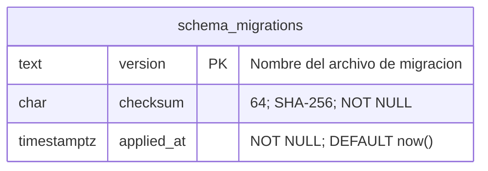

# Control técnico de migraciones

La preparación local crea `app_private.schema_migrations` para registrar migraciones aplicadas y detectar cambios en un archivo ya ejecutado. Es una tabla técnica de infraestructura: se cuenta aparte de las 12 tablas de IAM, CRM y auditoría y no introduce un dominio ni entidades de autenticación.

No tiene FK hacia otras tablas. `version` identifica el archivo; no es la versión de PostgreSQL. `checksum` guarda el resumen SHA-256 del contenido SQL y `applied_at` la fecha de aplicación registrada. No contiene contraseñas, usuarios del ERP, sesiones o datos de clientes.

## Funcionamiento del script

`scripts/local-postgres.cjs` admite `setup`, `start`, `stop` y `status`. Por ahora se ejecuta con Node 22 disponible en esta Mac. `setup` inicia el entorno local, crea la base si falta y revisa el historial antes de aplicar `001_customer_domain.sql`, `003_local_security.sql` y `004_function_defaults.sql`. No ejecuta semillas ni el adaptador Supabase `002`. La operación se describe en `database/LOCAL_SETUP.md`.

La migración y su inserción en el historial se confirman en la misma transacción. Si un archivo registrado conserva el checksum, se omite; si cambió, el script se detiene y exige una migración nueva. Tampoco adopta una base con tablas de dominio sin historial: conserva los datos y pide revisión.

`003_local_security.sql` asigna la propiedad de la tabla técnica a `comecore_owner`. El rol de aplicación no recibe permisos sobre ella; el script la usa mediante administración local. El checksum acredita el contenido registrado por el flujo de aplicación, no sustituye pruebas de comportamiento, revisión de permisos ni copias de seguridad.

## Estado registrado el 2026-10-09

La tarea principal confirmó la creación de `comecore` mediante `00_create_database.sql` y tres entradas de historial para `001_customer_domain.sql`, `003_local_security.sql` y `004_function_defaults.sql`. La creación inicial de la base es un paso separado del historial de esas tres migraciones. No se aplicó la semilla. Las pruebas SQL de autorización local fueron satisfactorias y se registran en [[2026-10-09|la bitácora]].

Un cambio futuro de tablas o políticas debe tener una migración nueva, su nota técnica y los diagramas correspondientes actualizados. Las sumas completas, fechas exactas u otros resultados de consultas solo deben registrarse si se han obtenido; no se inventan en la documentación.

## Estado verificado el 14 de octubre de 2026

El historial conserva 10 migraciones aplicadas. `002` es un adaptador Supabase no usado en este despliegue local. No se alteraron las migraciones registradas.

| Migración | SHA-256 |
|---|---|
| `001_customer_domain.sql` | `578f21bd7c8e1bb8d95abad0b8d45d09da8ef1a250a69504f0781e7701813dc1` |
| `003_local_security.sql` | `41698e5f75f9268acf8f2ca21f2ff672e7872e78083896c87a8857cfd3ab5caa` |
| `004_function_defaults.sql` | `a74c1a47bfbb5a9f956fce45d865ba33dcc7540605467868cb084b4b1ef5e3d6` |
| `005_authentication.sql` | `7f6a4360d9462642369e4d0131768e2eafbd28117d33c1f8ebef1ce4eb32cb21` |
| `006_secure_workspace.sql` | `106e456d24f6e47a7ec42a7917798d55fed885c6ff68a430dab34c1cfbbf0c48` |
| `007_erp_domains.sql` | `100a1e5892f6992a7ef0716be4f564fee26e48f3ac4dad0203f91412497fb61d` |
| `008_module_completion.sql` | `59d619c090f6cd8d49e856a35d54690a61dff50d77df19c04505024dd0732bc4` |
| `009_document_and_network_boundaries.sql` | `b5a3cdd93bfa5ef0cb0b63f92c8d0d9fbdba11bacf86923dd04d0ce1e4245066` |
| `010_coverage_fields.sql` | `ad3ab41c4c1e4d2fd09ffeb0efdc17550c1ba102dd137768b161bd82b912a0bf` |
| `011_plan_strategy_options.sql` | `9b79861e42c693129b84eb43f6ee7614494134907373be2b9c84565c54f71fbd` |

Para una nueva migración: `node scripts/apply-database-migration.cjs 012_nombre.sql`. El script valida el historial, serializa la aplicación con advisory lock y confirma la migración y su checksum en una transacción. No volver a ejecutar `setup` para aplicar un cambio de dominio. Revisar después SQL, permisos, pruebas, diagramas y respaldo.

[[11-Modelo-ERP-Completo]] · [[Bitacora/2026-10-14-Modelo-Completo]]
