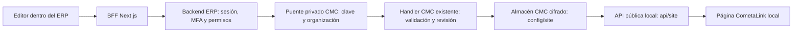

# Sitio web y contenido (CMC)

El ERP incorpora `/sitio-web` para administrar el contenido y la apariencia de
CometaLink. Reutiliza por copia los editores, el modelo y las doce paletas del
CMC existente. El código original no se movió. La contestadora, servicios,
usuarios, parámetros y analítica permanecen en el CMC original.

## Alcance comprobable

- Contenido: empresa, contacto, presentación, misión/visión/valores, oferta,
  emisoras públicas, preguntas frecuentes, textos por sección y aviso de mantenimiento.
- Apariencia: doce temáticas, ocho colores, mensajes de temporada y vista previa
  de la paleta sobre el contenido publicado. Los textos del borrador se comprueban
  después de publicarlos en la copia local.
- Borrador en memoria, confirmación de publicación, descarte y aviso al salir.
- Publicación en una **copia local** de la página; `cometalink.net` no se modifica.
- Sesión del ERP y MFA: no se muestra un segundo login del CMC dentro del módulo.
- Por ahora solo `owner`/`admin` reciben `sitio-web:read` y `sitio-web:write`.
  Estos permisos se validan tanto en el BFF como en el backend.

El interruptor del modo de mantenimiento pertenece a los Parámetros del CMC
original. Aquí se edita el texto del aviso; no se simula una activación.

## Flujo y almacenamiento



Identidades y sesiones siguen en PostgreSQL. El contenido del CMC conserva su
almacenamiento cifrado en archivos; esta entrega **no crea tablas PostgreSQL**.
No se modificó el esquema, por lo que no hay nueva migración ni ERD DBeaver.
El diagrama anterior describe la integración, no un modelo relacional ficticio.

El puente se vincula a una sola organización activa. El navegador no elige la
organización, actor, rol, destino del puente ni su clave. El backend construye
estos datos a partir de la sesión verificada. El puente concede exclusivamente
`content:read`/`content:write`, nunca `*`, y no acepta operaciones de cuentas,
contraseñas, MFA, recuperación, monitores o parámetros.

El contenido inicial se copió de la API pública de CometaLink al almacén local
cifrado. La copia no incluye cuentas ni credenciales. Una inicialización posterior
conserva el contenido local y no lo sobrescribe.

## Control de versiones

La lectura devuelve una revisión SHA-256 del documento público. La publicación
exige esa revisión y un documento completo. Un conflicto devuelve HTTP 409 y
conserva el borrador del editor. El handler serializa comparación y escritura
con el bloqueo existente dentro de su proceso. El bloqueo **no coordina procesos
escritores independientes**: producción requiere un único propietario de la
escritura o transacciones y bloqueo compartido. El servidor local de la web se
utiliza para lectura y vista previa; las publicaciones se hacen desde el ERP.

## Arranque local

Con Node 22 del proyecto y PostgreSQL local activo, desde la raíz del ERP:

```sh
node scripts/setup-cmc-local.cjs --cmc-root /ruta/al/proyecto/cometalink
node scripts/initialize-cmc-local.mjs --from-public
node scripts/run-cmc-local.cjs bridge
node scripts/run-cmc-local.cjs site
```

Los dos últimos comandos se mantienen en terminales separadas. Reiniciar el
backend ERP después de configurar la conexión. El frontend sigue en
`http://localhost:3000`, la web local en `http://localhost:3100` y el puente en
`127.0.0.1:3101`. Ambos servicios CMC se enlazan exclusivamente a loopback.

El configurador genera secretos fuera de Git con permisos 0600 y directorio
0700; las claves no se imprimen ni se entregan al frontend. El backend añade
`CMC_BRIDGE_URL`, `CMC_BRIDGE_SECRET` y `CMC_PUBLIC_URL` a su archivo privado.
La configuración versionada contiene únicamente nombres y ejemplos sin claves.
El CLI del puente rechaza el arranque como producción.

## Verificación

| Evidencia | Resultado y límite |
| --- | --- |
| Backend ERP CMC | 37 pruebas aprobadas con identidad/upstream controlados: permisos, MFA, CSRF, JSON, tamaño, actor/organización, conexión local y fallo cerrado. |
| BFF CMC | 10 escenarios aprobados sobre la ruta real con upstream controlado. |
| Puente y regresión CMC | 26 tests aprobados, incluyendo 15 casos HTTP del puente con handler y almacén cifrado reales y regresión del CMC original. |
| Flujo completo local | 14 controles aprobados con PostgreSQL, sesiones y MFA reales, frontend, backend, puente y API de la página local. |
| Compilación | Backend NestJS y frontend Next.js compilados; ruta `/sitio-web` y API CMC incluidas. |
| Análisis estático | Oxlint con tipos del CMC backend y ESLint del módulo frontend aprobados. ESLint del checkout CMC original no puede iniciar porque falta su configuración; no se ocultó esa limitación. |

Las pruebas integrales comprueban acceso anónimo, contraseña sin MFA, origen
ajeno, parámetros de organización, actor falsificado, rol sin permiso,
administrador de otra organización, publicación real en `/api/site`, versión
antigua, restauración, clave del puente inválida y sesión revocada. Las cuentas
temporales se retiran después de la revisión visual.

## Pendientes concretos

1. Reconciliar este checkout CMC con los módulos y dominios actuales del servidor.
2. Instalar la integración en el proceso que posee el contenido publicado,
   definir transporte privado seguro y concurrencia entre escritores.
3. Verificar en el entorno público la sesión del ERP, HTTPS, secretos, MFA,
   permisos por sitio y publicación visible en la página pública.
4. Conectar contestadora, analítica y otras funciones con sus módulos del ERP
   cuando se autorice esa fase; conservar el CMC original hasta completar la transición.
5. Completar la verificación general de seguridad del ERP pendiente de la tarea
   anterior. Estos resultados verifican el módulo CMC local y no certifican todo el ERP.

Véase [[Bitacora/2026-10-12-CMC]] y [[01-Arquitectura-PostgreSQL-DBeaver]].
