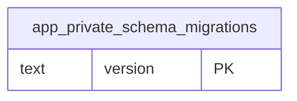

# Dominio app_private

Tablas propias: 1. Se muestran las PK y los enlaces de negocio; los tipos y columnas completos están en [[Diccionario]].

## Tablas implementadas

- **app_private.schema_migrations**: 3 columnas; tabla técnica con ACL privada.

## Cardinalidades de negocio

[[00-Relaciones|Volver al mapa de relaciones]]
