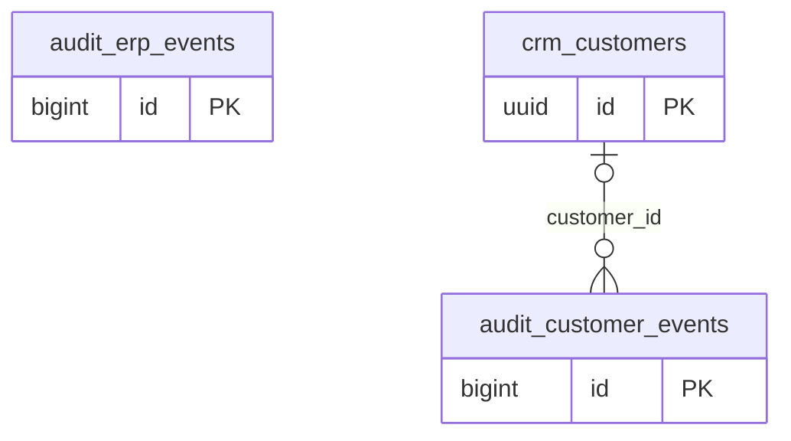

# Dominio audit

Tablas propias: 2. Se muestran las PK y los enlaces de negocio; los tipos y columnas completos están en [[Diccionario]].

## Tablas implementadas

- **audit.customer_events**: 10 columnas; RLS forzado.
- **audit.erp_events**: 9 columnas; RLS forzado.

## Cardinalidades de negocio

- crm.customers → audit.customer_events: **1:N**, padre opcional para cada hijo. FK: `customer_events_customer_id_fkey`.

[[00-Relaciones|Volver al mapa de relaciones]]
