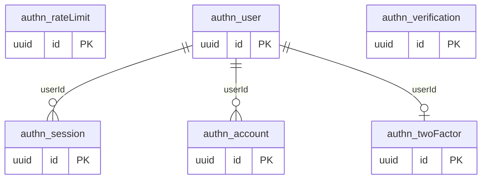

# Dominio authn

Tablas propias: 6. Se muestran las PK y los enlaces de negocio; los tipos y columnas completos están en [[Diccionario]].

## Tablas implementadas

- **authn.account**: 13 columnas; RLS forzado.
- **authn.rateLimit**: 4 columnas; RLS forzado.
- **authn.session**: 8 columnas; RLS forzado.
- **authn.twoFactor**: 7 columnas; RLS forzado.
- **authn.user**: 8 columnas; RLS forzado.
- **authn.verification**: 6 columnas; RLS forzado.

## Cardinalidades de negocio

- authn.user → authn.session: **1:N**, padre obligatorio para cada hijo. FK: `session_userId_fkey`.
- authn.user → authn.account: **1:N**, padre obligatorio para cada hijo. FK: `account_userId_fkey`.
- authn.user → authn.twoFactor: **1:1**, padre obligatorio para cada hijo. FK: `twoFactor_userId_fkey`.

[[00-Relaciones|Volver al mapa de relaciones]]
