# Dominio billing

Tablas propias: 12. Se muestran las PK y los enlaces de negocio; los tipos y columnas completos están en [[Diccionario]].

```mermaid
erDiagram
    billing_cash_audit_payments {
        uuid id PK
    }
    billing_cash_audits {
        uuid id PK
    }
    billing_credit_notes {
        uuid id PK
    }
    billing_invoice_items {
        uuid id PK
    }
    billing_invoices {
        uuid id PK
    }
    billing_ledger_entries {
        uuid id PK
    }
    billing_legal_entities {
        uuid id PK
    }
    billing_payment_allocations {
        uuid id PK
    }
    billing_payment_promises {
        uuid id PK
    }
    billing_payment_receipts {
        uuid id PK
    }
    billing_payments {
        uuid id PK
    }
    billing_service_billing_profiles {
        uuid id PK
    }
    service_contracts {
        uuid id PK
    }
    crm_customers {
        uuid id PK
    }
    iam_organization_memberships {
        uuid organization_id PK
        uuid user_id PK
    }
    documents_files {
        uuid id PK
    }
    service_contracts o|--o{ billing_invoices : "contract_id, customer_id"
    crm_customers ||--o{ billing_invoices : "customer_id"
    billing_legal_entities ||--o{ billing_invoices : "legal_entity_id"
    billing_invoices ||--o{ billing_invoice_items : "invoice_id"
    billing_invoices ||--o{ billing_credit_notes : "invoice_id"
    iam_organization_memberships o|--o{ billing_payments : "collector_user_id"
    crm_customers ||--o{ billing_payments : "customer_id"
    billing_invoices ||--o{ billing_payment_allocations : "invoice_id, customer_id, currency"
    billing_payments ||--o{ billing_payment_allocations : "payment_id, customer_id, currency"
    service_contracts o|--o{ billing_payment_promises : "contract_id, customer_id"
    crm_customers ||--o{ billing_payment_promises : "customer_id"
    crm_customers ||--o{ billing_payment_receipts : "customer_id"
    billing_payments o|--o{ billing_payment_receipts : "payment_id, customer_id"
    documents_files o|--o{ billing_payment_receipts : "file_id, file_purpose"
    documents_files o|--o{ billing_payment_receipts : "file_id"
    billing_invoices o|--o{ billing_payment_receipts : "invoice_id, customer_id"
    billing_cash_audits ||--o{ billing_cash_audit_payments : "cash_audit_id, currency"
    billing_payments ||--o{ billing_cash_audit_payments : "payment_id, currency"
    crm_customers ||--o{ billing_ledger_entries : "customer_id"
    billing_invoices o|--o{ billing_ledger_entries : "invoice_id, customer_id, currency"
    billing_payments o|--o{ billing_ledger_entries : "payment_id, customer_id, currency"
```

## Tablas implementadas

- **billing.cash_audit_payments**: 11 columnas; RLS forzado.
- **billing.cash_audits**: 16 columnas; RLS forzado.
- **billing.credit_notes**: 15 columnas; RLS forzado.
- **billing.invoice_items**: 15 columnas; RLS forzado.
- **billing.invoices**: 24 columnas; RLS forzado.
- **billing.ledger_entries**: 17 columnas; RLS forzado.
- **billing.legal_entities**: 11 columnas; RLS forzado.
- **billing.payment_allocations**: 13 columnas; RLS forzado.
- **billing.payment_promises**: 16 columnas; RLS forzado.
- **billing.payment_receipts**: 17 columnas; RLS forzado.
- **billing.payments**: 18 columnas; RLS forzado.
- **billing.service_billing_profiles**: 11 columnas; RLS forzado.

## Cardinalidades de negocio

- service.contracts → billing.invoices: **1:N**, padre opcional para cada hijo. FK: `invoices_organization_id_contract_id_customer_id_fkey`.
- crm.customers → billing.invoices: **1:N**, padre obligatorio para cada hijo. FK: `invoices_organization_id_customer_id_fkey`.
- billing.legal_entities → billing.invoices: **1:N**, padre obligatorio para cada hijo. FK: `invoices_organization_id_legal_entity_id_fkey`.
- billing.invoices → billing.invoice_items: **1:N**, padre obligatorio para cada hijo. FK: `invoice_items_organization_id_invoice_id_fkey`.
- billing.invoices → billing.credit_notes: **1:N**, padre obligatorio para cada hijo. FK: `credit_notes_organization_id_invoice_id_fkey`.
- iam.organization_memberships → billing.payments: **1:N**, padre opcional para cada hijo. FK: `payments_organization_id_collector_user_id_fkey`.
- crm.customers → billing.payments: **1:N**, padre obligatorio para cada hijo. FK: `payments_organization_id_customer_id_fkey`.
- billing.invoices → billing.payment_allocations: **1:N**, padre obligatorio para cada hijo. FK: `payment_allocations_organization_id_invoice_id_customer_id_fkey`.
- billing.payments → billing.payment_allocations: **1:N**, padre obligatorio para cada hijo. FK: `payment_allocations_organization_id_payment_id_customer_id_fkey`.
- service.contracts → billing.payment_promises: **1:N**, padre opcional para cada hijo. FK: `payment_promises_organization_id_contract_id_customer_id_fkey`.
- crm.customers → billing.payment_promises: **1:N**, padre obligatorio para cada hijo. FK: `payment_promises_organization_id_customer_id_fkey`.
- crm.customers → billing.payment_receipts: **1:N**, padre obligatorio para cada hijo. FK: `payment_receipts_organization_id_customer_id_fkey`.
- billing.payments → billing.payment_receipts: **1:N**, padre opcional para cada hijo. FK: `payment_receipts_organization_id_payment_id_customer_id_fkey`.
- documents.files → billing.payment_receipts: **1:N**, padre opcional para cada hijo. FK: `receipt_file_purpose_fk`.
- documents.files → billing.payment_receipts: **1:N**, padre opcional para cada hijo. FK: `receipts_file_fk`.
- billing.invoices → billing.payment_receipts: **1:N**, padre opcional para cada hijo. FK: `receipts_invoice_customer_fk`.
- billing.cash_audits → billing.cash_audit_payments: **1:N**, padre obligatorio para cada hijo. FK: `cash_audit_payments_audit_currency_fk`.
- billing.payments → billing.cash_audit_payments: **1:N**, padre obligatorio para cada hijo. FK: `cash_audit_payments_payment_currency_fk`.
- crm.customers → billing.ledger_entries: **1:N**, padre obligatorio para cada hijo. FK: `ledger_entries_organization_id_customer_id_fkey`.
- billing.invoices → billing.ledger_entries: **1:N**, padre opcional para cada hijo. FK: `ledger_entries_organization_id_invoice_id_customer_id_curr_fkey`.
- billing.payments → billing.ledger_entries: **1:N**, padre opcional para cada hijo. FK: `ledger_entries_organization_id_payment_id_customer_id_curr_fkey`.

[[00-Relaciones|Volver al mapa de relaciones]]
