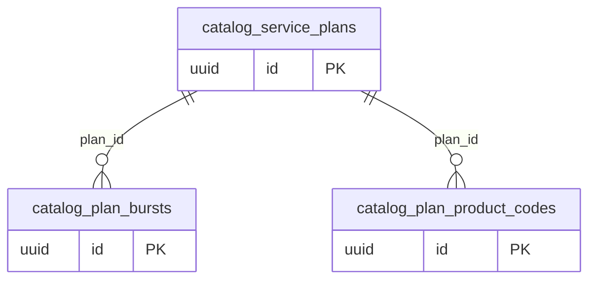

# Dominio catalog

Tablas propias: 3. Se muestran las PK y los enlaces de negocio; los tipos y columnas completos están en [[Diccionario]].

## Tablas implementadas

- **catalog.plan_bursts**: 14 columnas; RLS forzado.
- **catalog.plan_product_codes**: 11 columnas; RLS forzado.
- **catalog.service_plans**: 20 columnas; RLS forzado.

## Cardinalidades de negocio

- catalog.service_plans → catalog.plan_bursts: **1:N**, padre obligatorio para cada hijo. FK: `plan_bursts_organization_id_plan_id_fkey`.
- catalog.service_plans → catalog.plan_product_codes: **1:N**, padre obligatorio para cada hijo. FK: `plan_product_codes_organization_id_plan_id_fkey`.

[[00-Relaciones|Volver al mapa de relaciones]]
