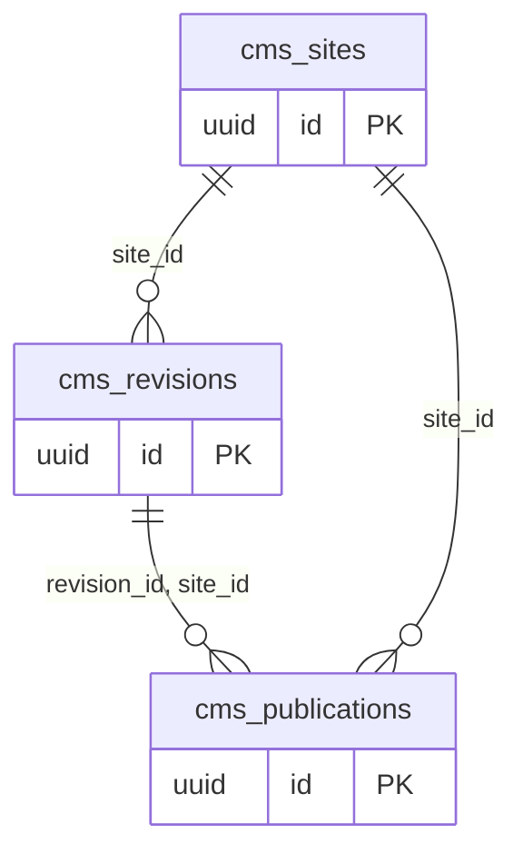

# Dominio cms

Tablas propias: 3. Se muestran las PK y los enlaces de negocio; los tipos y columnas completos están en [[Diccionario]].

## Tablas implementadas

- **cms.publications**: 13 columnas; RLS forzado.
- **cms.revisions**: 13 columnas; RLS forzado.
- **cms.sites**: 11 columnas; RLS forzado.

## Cardinalidades de negocio

- cms.sites → cms.revisions: **1:N**, padre obligatorio para cada hijo. FK: `revisions_organization_id_site_id_fkey`.
- cms.revisions → cms.publications: **1:N**, padre obligatorio para cada hijo. FK: `publications_organization_id_revision_id_site_id_fkey`.
- cms.sites → cms.publications: **1:N**, padre obligatorio para cada hijo. FK: `publications_organization_id_site_id_fkey`.

[[00-Relaciones|Volver al mapa de relaciones]]
