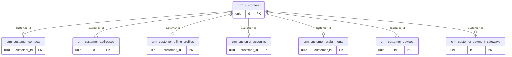

# Dominio crm

Tablas propias: 8. Se muestran las PK y los enlaces de negocio; los tipos y columnas completos están en [[Diccionario]].

## Tablas implementadas

- **crm.customer_accounts**: 9 columnas; RLS forzado.
- **crm.customer_addresses**: 17 columnas; RLS forzado.
- **crm.customer_assignments**: 7 columnas; RLS forzado.
- **crm.customer_billing_profiles**: 21 columnas; RLS forzado.
- **crm.customer_contacts**: 10 columnas; RLS forzado.
- **crm.customer_devices**: 11 columnas; RLS forzado.
- **crm.customer_payment_gateways**: 9 columnas; RLS forzado.
- **crm.customers**: 20 columnas; RLS forzado.

## Cardinalidades de negocio

- crm.customers → crm.customer_contacts: **1:1**, padre obligatorio para cada hijo. FK: `customer_contacts_customer_fk`.
- crm.customers → crm.customer_addresses: **1:N**, padre obligatorio para cada hijo. FK: `customer_addresses_customer_fk`.
- crm.customers → crm.customer_billing_profiles: **1:1**, padre obligatorio para cada hijo. FK: `customer_billing_profiles_customer_fk`.
- crm.customers → crm.customer_accounts: **1:1**, padre obligatorio para cada hijo. FK: `customer_accounts_customer_fk`.
- crm.customers → crm.customer_assignments: **1:1**, padre obligatorio para cada hijo. FK: `customer_assignments_customer_fk`.
- crm.customers → crm.customer_devices: **1:N**, padre obligatorio para cada hijo. FK: `customer_devices_customer_fk`.
- crm.customers → crm.customer_payment_gateways: **1:N**, padre obligatorio para cada hijo. FK: `customer_payment_gateways_customer_fk`.

[[00-Relaciones|Volver al mapa de relaciones]]
