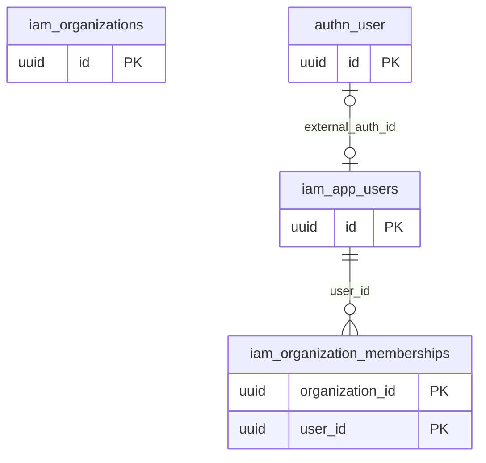

# Dominio iam

Tablas propias: 3. Se muestran las PK y los enlaces de negocio; los tipos y columnas completos están en [[Diccionario]].

## Tablas implementadas

- **iam.app_users**: 8 columnas; RLS forzado.
- **iam.organization_memberships**: 6 columnas; RLS forzado.
- **iam.organizations**: 6 columnas; RLS forzado.

## Cardinalidades de negocio

- authn.user → iam.app_users: **1:1**, padre opcional para cada hijo. FK: `app_users_external_auth_fk`.
- iam.app_users → iam.organization_memberships: **1:N**, padre obligatorio para cada hijo. FK: `organization_memberships_user_id_fkey`.

[[00-Relaciones|Volver al mapa de relaciones]]
