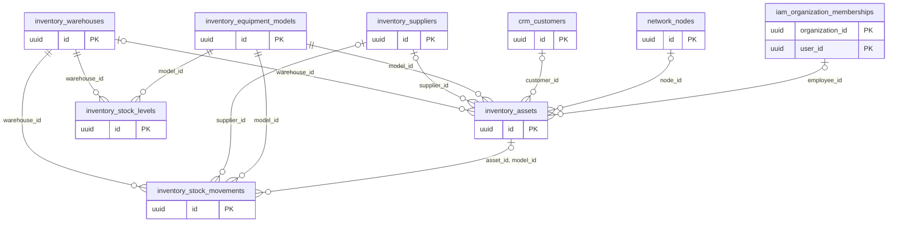

# Dominio inventory

Tablas propias: 6. Se muestran las PK y los enlaces de negocio; los tipos y columnas completos están en [[Diccionario]].

## Tablas implementadas

- **inventory.assets**: 20 columnas; RLS forzado.
- **inventory.equipment_models**: 15 columnas; RLS forzado.
- **inventory.stock_levels**: 14 columnas; RLS forzado.
- **inventory.stock_movements**: 17 columnas; RLS forzado.
- **inventory.suppliers**: 13 columnas; RLS forzado.
- **inventory.warehouses**: 11 columnas; RLS forzado.

## Cardinalidades de negocio

- inventory.equipment_models → inventory.stock_levels: **1:N**, padre obligatorio para cada hijo. FK: `stock_levels_organization_id_model_id_fkey`.
- inventory.warehouses → inventory.stock_levels: **1:N**, padre obligatorio para cada hijo. FK: `stock_levels_organization_id_warehouse_id_fkey`.
- iam.organization_memberships → inventory.assets: **1:N**, padre opcional para cada hijo. FK: `assets_employee_membership_fk`.
- network.nodes → inventory.assets: **1:N**, padre opcional para cada hijo. FK: `assets_node_fk`.
- crm.customers → inventory.assets: **1:N**, padre opcional para cada hijo. FK: `assets_organization_id_customer_id_fkey`.
- inventory.equipment_models → inventory.assets: **1:N**, padre obligatorio para cada hijo. FK: `assets_organization_id_model_id_fkey`.
- inventory.suppliers → inventory.assets: **1:N**, padre opcional para cada hijo. FK: `assets_organization_id_supplier_id_fkey`.
- inventory.warehouses → inventory.assets: **1:N**, padre opcional para cada hijo. FK: `assets_organization_id_warehouse_id_fkey`.
- inventory.assets → inventory.stock_movements: **1:N**, padre opcional para cada hijo. FK: `stock_movements_asset_model_fk`.
- inventory.equipment_models → inventory.stock_movements: **1:N**, padre obligatorio para cada hijo. FK: `stock_movements_organization_id_model_id_fkey`.
- inventory.suppliers → inventory.stock_movements: **1:N**, padre opcional para cada hijo. FK: `stock_movements_organization_id_supplier_id_fkey`.
- inventory.warehouses → inventory.stock_movements: **1:N**, padre obligatorio para cada hijo. FK: `stock_movements_organization_id_warehouse_id_fkey`.

[[00-Relaciones|Volver al mapa de relaciones]]
