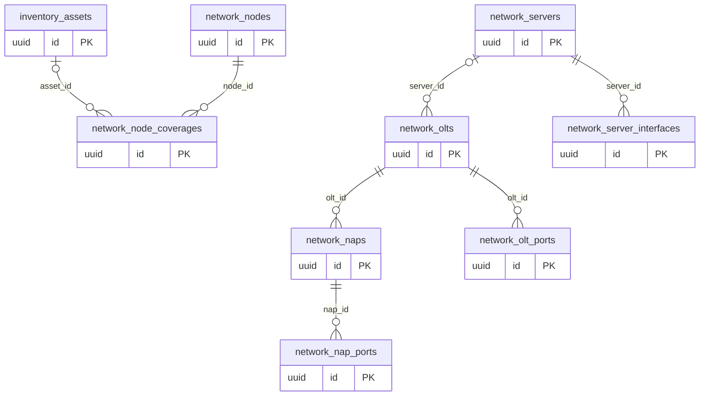

# Dominio network

Tablas propias: 8. Se muestran las PK y los enlaces de negocio; los tipos y columnas completos están en [[Diccionario]].

## Tablas implementadas

- **network.nap_ports**: 11 columnas; RLS forzado.
- **network.naps**: 12 columnas; RLS forzado.
- **network.node_coverages**: 15 columnas; RLS forzado.
- **network.nodes**: 14 columnas; RLS forzado.
- **network.olt_ports**: 11 columnas; RLS forzado.
- **network.olts**: 11 columnas; RLS forzado.
- **network.server_interfaces**: 13 columnas; RLS forzado.
- **network.servers**: 20 columnas; RLS forzado.

## Cardinalidades de negocio

- network.servers → network.server_interfaces: **1:N**, padre obligatorio para cada hijo. FK: `server_interfaces_organization_id_server_id_fkey`.
- inventory.assets → network.node_coverages: **1:N**, padre opcional para cada hijo. FK: `coverage_asset_fk`.
- network.nodes → network.node_coverages: **1:N**, padre obligatorio para cada hijo. FK: `node_coverages_organization_id_node_id_fkey`.
- network.servers → network.olts: **1:N**, padre opcional para cada hijo. FK: `olts_organization_id_server_id_fkey`.
- network.olts → network.olt_ports: **1:N**, padre obligatorio para cada hijo. FK: `olt_ports_organization_id_olt_id_fkey`.
- network.olts → network.naps: **1:N**, padre obligatorio para cada hijo. FK: `naps_organization_id_olt_id_fkey`.
- network.naps → network.nap_ports: **1:N**, padre obligatorio para cada hijo. FK: `nap_ports_organization_id_nap_id_fkey`.

[[00-Relaciones|Volver al mapa de relaciones]]
