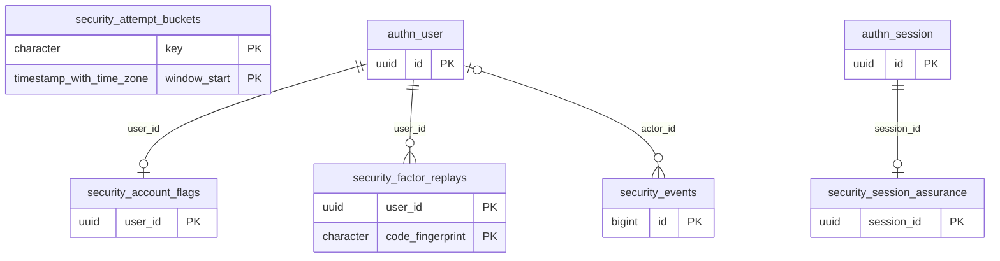

# Dominio security

Tablas propias: 5. Se muestran las PK y los enlaces de negocio; los tipos y columnas completos están en [[Diccionario]].

## Tablas implementadas

- **security.account_flags**: 3 columnas; RLS forzado.
- **security.attempt_buckets**: 3 columnas; RLS forzado.
- **security.events**: 6 columnas; RLS forzado.
- **security.factor_replays**: 3 columnas; RLS forzado.
- **security.session_assurance**: 2 columnas; RLS forzado.

## Cardinalidades de negocio

- authn.user → security.account_flags: **1:1**, padre obligatorio para cada hijo. FK: `account_flags_user_id_fkey`.
- authn.session → security.session_assurance: **1:1**, padre obligatorio para cada hijo. FK: `session_assurance_session_id_fkey`.
- authn.user → security.factor_replays: **1:N**, padre obligatorio para cada hijo. FK: `factor_replays_user_id_fkey`.
- authn.user → security.events: **1:N**, padre opcional para cada hijo. FK: `events_actor_id_fkey`.

[[00-Relaciones|Volver al mapa de relaciones]]
