# Dominio service

Tablas propias: 7. Se muestran las PK y los enlaces de negocio; los tipos y columnas completos están en [[Diccionario]].

```mermaid
erDiagram
    service_contract_connections {
        uuid id PK
    }
    service_contract_discounts {
        uuid id PK
    }
    service_contract_items {
        uuid id PK
    }
    service_contract_olt_connections {
        uuid id PK
    }
    service_contract_recurring_items {
        uuid id PK
    }
    service_contract_usage_samples {
        uuid id PK
    }
    service_contracts {
        uuid id PK
    }
    billing_service_billing_profiles {
        uuid id PK
    }
    crm_customers {
        uuid id PK
    }
    billing_legal_entities {
        uuid id PK
    }
    network_nodes {
        uuid id PK
    }
    catalog_service_plans {
        uuid id PK
    }
    network_servers {
        uuid id PK
    }
    network_server_interfaces {
        uuid id PK
    }
    network_naps {
        uuid id PK
    }
    network_nap_ports {
        uuid id PK
    }
    network_olts {
        uuid id PK
    }
    network_olt_ports {
        uuid id PK
    }
    inventory_assets {
        uuid id PK
    }
    billing_service_billing_profiles o|--o{ service_contracts : "billing_profile_id"
    crm_customers ||--o{ service_contracts : "customer_id"
    billing_legal_entities o|--o{ service_contracts : "legal_entity_id"
    network_nodes ||--o{ service_contracts : "node_id"
    catalog_service_plans ||--o{ service_contracts : "plan_id"
    network_servers ||--o{ service_contracts : "server_id"
    service_contracts ||--o| service_contract_connections : "contract_id, server_id"
    network_server_interfaces ||--o{ service_contract_connections : "interface_id, server_id"
    service_contracts ||--o| service_contract_olt_connections : "contract_id"
    network_naps o|--o{ service_contract_olt_connections : "nap_id, olt_id"
    network_nap_ports o|--o{ service_contract_olt_connections : "nap_port_id, nap_id"
    network_olts ||--o{ service_contract_olt_connections : "olt_id"
    network_olt_ports o|--o{ service_contract_olt_connections : "olt_port_id, olt_id"
    service_contracts ||--o{ service_contract_discounts : "contract_id"
    service_contracts ||--o{ service_contract_recurring_items : "contract_id"
    inventory_assets o|--o{ service_contract_items : "asset_id, customer_id"
    service_contracts ||--o{ service_contract_items : "contract_id, customer_id"
    inventory_assets o|--o{ service_contract_items : "asset_id"
    service_contracts ||--o{ service_contract_items : "contract_id"
    service_contracts ||--o{ service_contract_usage_samples : "contract_id"
```

## Tablas implementadas

- **service.contract_connections**: 33 columnas; RLS forzado.
- **service.contract_discounts**: 14 columnas; RLS forzado.
- **service.contract_items**: 12 columnas; RLS forzado.
- **service.contract_olt_connections**: 23 columnas; RLS forzado.
- **service.contract_recurring_items**: 13 columnas; RLS forzado.
- **service.contract_usage_samples**: 13 columnas; RLS forzado.
- **service.contracts**: 30 columnas; RLS forzado.

## Cardinalidades de negocio

- billing.service_billing_profiles → service.contracts: **1:N**, padre opcional para cada hijo. FK: `contracts_organization_id_billing_profile_id_fkey`.
- crm.customers → service.contracts: **1:N**, padre obligatorio para cada hijo. FK: `contracts_organization_id_customer_id_fkey`.
- billing.legal_entities → service.contracts: **1:N**, padre opcional para cada hijo. FK: `contracts_organization_id_legal_entity_id_fkey`.
- network.nodes → service.contracts: **1:N**, padre obligatorio para cada hijo. FK: `contracts_organization_id_node_id_fkey`.
- catalog.service_plans → service.contracts: **1:N**, padre obligatorio para cada hijo. FK: `contracts_organization_id_plan_id_fkey`.
- network.servers → service.contracts: **1:N**, padre obligatorio para cada hijo. FK: `contracts_organization_id_server_id_fkey`.
- service.contracts → service.contract_connections: **1:1**, padre obligatorio para cada hijo. FK: `contract_connections_organization_id_contract_id_server_id_fkey`.
- network.server_interfaces → service.contract_connections: **1:N**, padre obligatorio para cada hijo. FK: `contract_connections_organization_id_interface_id_server_i_fkey`.
- service.contracts → service.contract_olt_connections: **1:1**, padre obligatorio para cada hijo. FK: `contract_olt_connections_organization_id_contract_id_fkey`.
- network.naps → service.contract_olt_connections: **1:N**, padre opcional para cada hijo. FK: `contract_olt_connections_organization_id_nap_id_olt_id_fkey`.
- network.nap_ports → service.contract_olt_connections: **1:N**, padre opcional para cada hijo. FK: `contract_olt_connections_organization_id_nap_port_id_nap_i_fkey`.
- network.olts → service.contract_olt_connections: **1:N**, padre obligatorio para cada hijo. FK: `contract_olt_connections_organization_id_olt_id_fkey`.
- network.olt_ports → service.contract_olt_connections: **1:N**, padre opcional para cada hijo. FK: `contract_olt_connections_organization_id_olt_port_id_olt_i_fkey`.
- service.contracts → service.contract_discounts: **1:N**, padre obligatorio para cada hijo. FK: `contract_discounts_organization_id_contract_id_fkey`.
- service.contracts → service.contract_recurring_items: **1:N**, padre obligatorio para cada hijo. FK: `contract_recurring_items_organization_id_contract_id_fkey`.
- inventory.assets → service.contract_items: **1:N**, padre opcional para cada hijo. FK: `contract_items_asset_customer_fk`.
- service.contracts → service.contract_items: **1:N**, padre obligatorio para cada hijo. FK: `contract_items_contract_customer_fk`.
- inventory.assets → service.contract_items: **1:N**, padre opcional para cada hijo. FK: `contract_items_organization_id_asset_id_fkey`.
- service.contracts → service.contract_items: **1:N**, padre obligatorio para cada hijo. FK: `contract_items_organization_id_contract_id_fkey`.
- service.contracts → service.contract_usage_samples: **1:N**, padre obligatorio para cada hijo. FK: `contract_usage_samples_organization_id_contract_id_fkey`.

[[00-Relaciones|Volver al mapa de relaciones]]
