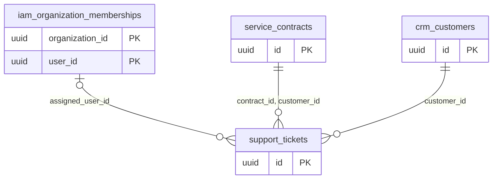

# Dominio support

Tablas propias: 1. Se muestran las PK y los enlaces de negocio; los tipos y columnas completos están en [[Diccionario]].

## Tablas implementadas

- **support.tickets**: 18 columnas; RLS forzado.

## Cardinalidades de negocio

- iam.organization_memberships → support.tickets: **1:N**, padre opcional para cada hijo. FK: `tickets_organization_id_assigned_user_id_fkey`.
- service.contracts → support.tickets: **1:N**, padre obligatorio para cada hijo. FK: `tickets_organization_id_contract_id_customer_id_fkey`.
- crm.customers → support.tickets: **1:N**, padre obligatorio para cada hijo. FK: `tickets_organization_id_customer_id_fkey`.

[[00-Relaciones|Volver al mapa de relaciones]]
